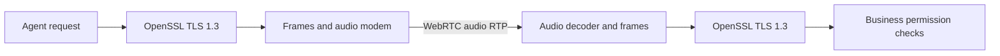

# Architecture and library usage

[README](../README.md) · [Business case](business.md) · [Quickstart](quickstart.md) · [Authority](authority.md)

OpenAVT places an audio modem beneath OpenSSL's TLS byte stream. The application
uses TLS-protected JSON requests; the modem delivers the TLS records through audio.



The reverse path carries the protected response. SDP establishes the call out
of band; inner TLS records and application requests use audio only. WebRTC also
protects the audio leg with SRTP. Recordings are evidence, not the delivery path.

## Components

| Module | Responsibility |
| --- | --- |
| [`tls.py`](../src/openavt/tls.py) | TLS endpoint using `ssl.MemoryBIO` and the caller's `SSLContext` |
| [`protocol.py`](../src/openavt/protocol.py) | Frame format, CRC, FSK waveform and WAV helpers |
| [`channel.py`](../src/openavt/channel.py) | Ordered delivery, audio ACKs, retries and deduplication |
| [`modem.py`](../src/openavt/modem.py) / [`pcm.py`](../src/openavt/pcm.py) | Streaming FSK / digital G.711 decoding |
| [`transports/webrtc.py`](../src/openavt/transports/webrtc.py) | Live audio transport |
| [`authority/`](../src/openavt/authority/) | Enrollment and separate business delegation |
| [`agents/openai.py`](../src/openavt/agents/openai.py) | Independent LLM contexts, transcription and speech |
| [`demos/`](../src/openavt/demos/) | Call orchestration and demo policy |

Core modules do not import the demos or OpenAI. Optional integrations load only
when requested. The 0.x library API is experimental.

## Create a TLS endpoint

Configure your trust policy and client certificate explicitly:

```python
import ssl
from openavt.tls import Endpoint

context = ssl.create_default_context(cafile="your-trust-root.pem")
context.minimum_version = context.maximum_version = ssl.TLSVersion.TLSv1_3
context.load_cert_chain("client.pem", "client.key")
endpoint = Endpoint("client", context, server_hostname="service.example")
```

`endpoint.incoming` and `endpoint.outgoing` are MemoryBIOs; `endpoint.tls` is the
SSLObject. Server contexts must require client certificates for mutual TLS.
[`pki.py`](../src/openavt/pki.py) provides ephemeral demo certificates and contexts.

## Connect audio

Construct `AudioTLS(endpoint, send_audio, log, profile="pcm")`. The async callback
is `send_audio(samples, kind)`. Run `session.run(initiate=True)` for the client
and `session.run()` for the server; feed decoded frames to
`session.receive_frame(sequence, kind, payload)`. Await `wait_ready()` before
`send_json()` or `receive_json()`. Cancel the run tasks and await `close()` on exit.

Use `pcm.StreamDecoder` for the PCM profile or `modem.StreamDecoder` for FSK.
[`demos/live.py`](../src/openavt/demos/live.py) shows transport wiring and cleanup.

| Profile | Raw modem rate | Requirement |
| --- | ---: | --- |
| `voiceband` (default for `live`) | 1 kbps | Stable sample timing; no clock-drift recovery |
| `pcm` | 56 kbps | Unchanged 8 kHz mono PCMU samples |

PCM encodes seven bits using 128 exact mu-law reconstruction levels. The codec
preserves them; a prefix and CRC validate frame delivery. Larger frames and
reduced buffering produce the [sub-second measurements](performance.md).

## Enforce permissions

TLS authenticates certificate/key possession and protects structured messages.
Ordinary speech is outside inner TLS. CRC detects link errors; it supplies no
cryptographic authentication.

The business independently checks the peer certificate and signed customer
grant before acting. Enrollment and consent APIs use local HTTP or HTTPS outside
the audio call. See [backend integration and trust boundaries](authority.md#backend-integration).
The business signer is separate from the AVA root; LLM output cannot change its grants.

[TLS 1.3](https://www.rfc-editor.org/rfc/rfc8446.html) ·
[Python MemoryBIO](https://docs.python.org/3/library/ssl.html#memory-bio-support)
