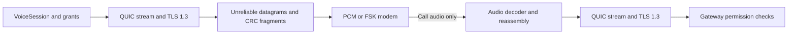

# QUIC over voice

OpenAVT can carry real QUIC v1 packets through its existing audio modems. Select
`protocol="quic"` on both `VoiceSession` endpoints. The default remains `"tls"`.
The same identities, AVA enrollment, signed grants, Gateway, PAP bridge, risk
monitor, speech scheduler and call adapters work with either protocol.

TLS over a byte stream needs reliable ordering; OpenAVT's original `AudioTLS`
already supplies this with stop-and-wait audio frames. The QUIC path instead
lets its own TLS 1.3 handshake, reliable streams and congestion controller recover
from lost, corrupted, duplicated and reordered datagrams. There is no audio-link
ACK or retransmission beneath QUIC, and no UDP socket carrying application bytes.



## Run from this checkout

Requires Python 3.11+ and an `openssl` executable for the certificate demos.

```sh
python -m pip install -e '.[quic,webrtc,authority,twilio,pap]'
openavt sdk-demo --protocol quic --output output/quic-webrtc
openavt sdk-demo --protocol quic --loss --output output/quic-webrtc-loss
openavt sdk-demo --protocol quic --loss --transport twilio-emulated --output output/quic-twilio-loss
openavt pap-demo --protocol quic --loss --output output/quic-pap-loss
```

Use a fresh output directory for each run. The SDK runs separate caller and
business processes. SDP or provider setup travels outside the audio; protected
requests and QUIC acknowledgments travel inside it. `--loss` drops bursts 1 and
12, damages burst 4 and duplicates burst 7 in **each** direction. These are
deterministic local waveform faults, not a statistical model of carrier loss.
The report includes actual injected faults and QUIC loss counters.

The SDK checks one permitted read and seven denied requests: scope escalation,
replay, another customer, expiry, a revoked grant, another key and a revoked
certificate. The PAP demo also checks fraud blocking, sign-out, and exactly-once
HTTPS confirmation. Its account credentials stay on HTTPS.

For the slower 1 kbps FSK profile:

```sh
openavt sdk-demo --protocol quic --profile voiceband --output output/quic-fsk
```

This takes several minutes. Use up to 150 seconds for handshake/request deadlines
when integrating FSK. The demo keeps existing grant and challenge expiry limits.
`--agents` also works with QUIC when the existing OpenAI integration is configured;
it requires separate credentials and has not been exercised in this verification.

## Integrate

```python
from openavt import Identity, VoiceSession

session = VoiceSession(
    audio=your_audio_adapter,
    identity=Identity.load("credentials"),
    trust="credentials/root.pem",
    expected_peer="desk.demo",
    protocol="quic",
    profile="pcm",
)
```

On the receiving endpoint use `server=True`, its service identity, and
`protocol="quic"`. The existing `Gateway` API and authorization policies are
unchanged. A timeout after submission still raises `RequestOutcomeUnknown`:
transport retransmission does not make an application write safe to retry.

## Wire and security profile

- QUIC v1, ALPN `openavt/1`, TLS 1.3; no session tickets, resumption or 0-RTT.
- Both peers prove certificate key possession. Explicit roots, validity,
  certificate purpose, digital-signature usage and non-CA leaf status are checked;
  the client also verifies the service hostname. The business still checks
  current certificate/grant revocation when authorizing requests.
- The client waits for an encrypted server confirmation on unidirectional
  stream 3 before it becomes verified or sends credentials. This confirmation
  follows server validation of its client certificate. Protected JSON uses
  client-initiated bidirectional stream 0 and the existing serialized request API.
- QUIC packets are limited to 1200 bytes. Audio kind 3 carries a four-byte
  fragment header (`index`, `count`, `total length`) and datagram fragments under
  the existing sequence/CRC frame. Each packet has an independent audio sequence;
  sequence gaps never block later packets. CRC detects damage, while QUIC packet
  protection authenticates bytes.
- PCM fits a packet into one frame; FSK needs up to five. Reassembly holds at
  most 16 partial packets, expires incomplete packets, and tolerates fragment
  duplication/reordering. It never retries missing fragments.
- The sender bounds its audio queue and serializes modem bursts through the
  existing scheduler. Initial RTT is 0.5 seconds for PCM and 25 seconds for FSK
  to account for audio serialization. The engine receives packets during playback,
  services QUIC timers between bounded output bursts, and drains final ACK audio
  before closing. Application messages are limited to 64 KiB.

The optional dependency is pinned to **aioquic 1.3.0**. Upstream does not expose
required client certificates, peer certificate retrieval, or stream ACK offsets
as public QUIC APIs. The small `_MutualQuicConnection` subclass isolates these
private hooks. Upgrade it only with the mutual-authentication, delivery and
shutdown tests passing. Loss counters retain metadata only, without full qlogs,
traffic secrets or request contents.

## Verification and limits

Run the suite with the QUIC extra enabled:

```sh
uv sync --locked --extra quic --extra webrtc --extra authority --extra twilio --extra pap
uv run --locked --extra quic --extra webrtc --extra authority --extra twilio --extra pap pytest -q
```

Tests include real independent WebRTC and emulated provider calls under audio
faults, FSK sample decoding, certificate rejection, corrupted ciphertext with a
valid audio CRC, reassembly bounds, large messages, ambiguous execution outcomes,
PAP/risk enforcement and final ACK playback. CI repeats QUIC demos from the
installed wheel outside the source directory. [Recorded evidence](quic-verification.json)
describes the locally executed scenarios.

QUIC tolerates packet loss; it does not repair a waveform the modem cannot
decode. PCM still requires an unchanged digital G.711 path. FSK still assumes
stable sample timing and lacks clock-drift recovery. Arbitrary speech processing,
resampling and transcoding can defeat either modem. Local audio verification is
not validation over public Internet, carrier/PSTN or microphones. Live Twilio,
remote interoperability and production security review remain unverified.

[aioquic sans-I/O QUIC API](https://aioquic.readthedocs.io/en/latest/quic.html) ·
[QUIC v1](https://www.rfc-editor.org/rfc/rfc9000.html) ·
[QUIC loss recovery](https://www.rfc-editor.org/rfc/rfc9002.html)
